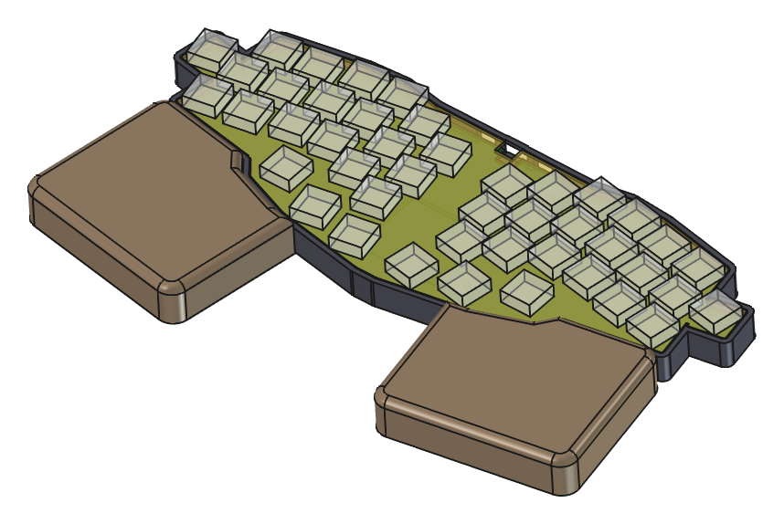
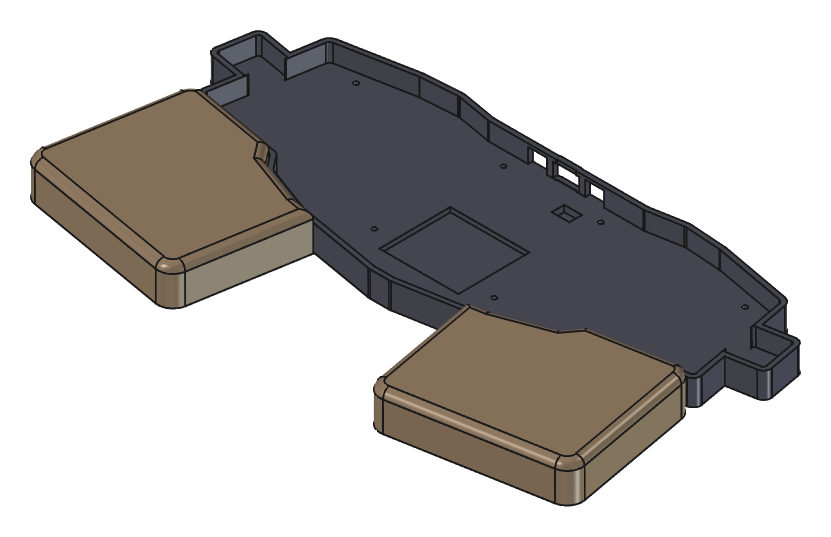

# tk44-case

3D-printable tray case and wrist rests for the
[Ladniy/TK44](https://github.com/Ladniy/TK44) wireless unibody keyboard,
generated by a parametric FreeCAD script.



**In plain words.** The stock TK44 is a sandwich of three boards: a switch
plate on top, the PCB, and an FR-4 bottom plate, held together by standoffs.
This project replaces the bottom plate with a printed **tray**: the
keyboard sits inside it, the sides are closed, and the underside has
recesses for rubber feet. Two **wrist rests** are printed separately and
sit right in front of the tray. All dimensions live in one Python script —
change a number, run one command, and get fresh STL/STEP files.



## Parts

| File (`out/`)                    | What                                     | Size, mm             |
| -------------------------------- | ---------------------------------------- | -------------------- |
| `tk44-tray.{stl,step}`           | Tray replacing the FR-4 bottom           | 295.9 × 105.6 × 13.6 |
| `tk44-wristrest-{left,right}.*`  | Free-standing wrist rests (mirror pair)  | 103.9 × 92.6 × 20    |
| `tk44-tray-vase-fit.*`           | Spiral-vase fit test (see below)         | 291.8 × 101.5 × 10.2 |

[`tk44-case.FCStd`](./tk44-case.FCStd) is the generated FreeCAD document
with all parts plus ghost PCB, plate and switches for reference. It is
rewritten on every build — edit [`tk44_case.py`](./tk44_case.py), not the
document.

## Hardware

Kept from the original kit: FR-4 switch plate, PCB, 8× M2×8 standoffs and
the 8 M2×5 screws on the plate side.

Extra:

- 8× **M2×6** screws with Ø4 × 0.5 mm flat heads, from below into the
  standoffs (Ø4.4 × 0.6 counterbore, 3.4 mm of floor under each standoff,
  2.6 mm of thread engaged; M2×5 would engage only 1.6 mm);
- rubber bumpers Ø10 mm — 8 for the tray, 3 per wrist rest.

## Build

With Nix (Linux), from the repo root:

```sh
nix run          # -> out/*.stl, out/*.step, tk44-case.FCStd
```

Without Nix, with FreeCAD ≥ 1.1 installed:

```sh
freecad -c tk44_case.py
```

Or inside a running FreeCAD (Python console), which only builds the
document without exporting:

```python
p = "/path/to/tk44-case/tk44_case.py"
exec(open(p).read(), {"__file__": p, "__name__": "tk44_case"})
```

All dimensions are in the `P = dict(...)` block at the top of
[`tk44_case.py`](./tk44_case.py). The script checks a few invariants
(screw engagement, screws not colliding inside the standoffs, bumpers
staying on the floor) and stops with an error if a change breaks them.

## Design

### Stack-up (Z = 0 at the tray underside)

| Z, mm        | Layer                                                         |
| ------------ | ------------------------------------------------------------- |
| 0 … 4.0      | tray floor: bumper recesses Ø10.5 × 1, screw counterbores     |
| 4.0 … 7.0    | 3 mm air gap — hot-swap sockets, power switch, reset button   |
| 7.0 … 8.6    | PCB                                                           |
| 12.0 … 13.6  | FR-4 plate; the wall top is flush with it                     |

The 8 mm standoffs stand on the floor and pass through the 4.4 mm PCB
holes to the plate, exactly like the original sandwich. The inner wall is
0.5 mm from the PCB/plate edge.

Floor pockets copy the cut-outs of the original FR-4 bottom:

- battery area 42 × 38, 2.5 mm deep → 5.5 mm under the PCB for a 502035 cell;
- JST battery connector 9.4 × 6.7, 3.4 mm deep.

### Back wall

Three openings, each closed by a bridge at the top:

- **USB-C** — 14 mm wide, Z 4.25 … 11.75, centred on the port (its top is
  4 mm below the plate top), 1.85 mm bridge;
- **power switch** and **reset button** — 10 mm wide, from the floor up
  to a 1.6 mm bridge at plate level. On the board revision this was made
  for, the reset button sits on the back edge, mirrored to the power
  switch around the USB port (±15.2 mm). Check yours.

### Wrist rests

Free-standing, on rubber bumpers. The back edge follows the tray's front
contour around the thumb cluster with a 0.5 mm gap. The top is 20 mm above
the desk (the plate top is at 13.6), edges filleted R4. An optional
vertical dovetail (`dovetail=True`) can lock them to the tray; it is off by
default.

## Printing

- Tray and rests print **as exported, bottom face down**, no supports:
  recesses open downwards, the back-wall openings are 10–14 mm bridges.
- **0.2 mm layers** (`layer_h`). Above every screw counterbore the model
  has sacrificial-bridge stages — a 2.4 mm slot, then a 2.4 mm square,
  `bridge_layers` (2) layers each — so any slicer bridges the counterbore
  ceiling with straight ~4 mm lines instead of circling it in mid-air.
  They fuse into the solid floor above; the hole and the thread engagement
  don't change.
- The tray is ~296 mm long: it needs a bed of at least 300 mm.
- PETG or PLA, 3+ walls.

### Vase-mode fit test

`tk44-tray-vase-fit` is a quick, cheap print for checking the cavity
against the real keyboard before committing to the full tray. It is a
solid body: in spiral vase mode the slicer prints only its outline as a
single wall, and that wall's **inner** face lands exactly on the tray's
inner wall.

- The outline is the cavity grown by `vase_line_w` (0.45 mm). Set the
  slicer's outer wall line width to the same value, or change the
  parameter.
- It runs from 0.6 mm below the tray floor top to the plate top, so with
  the stock standoffs on its floor the keyboard sits as in the tray. Use 3
  bottom layers at 0.2 mm (`vase_bottom`), or 0 for an open ring.
- A vase wall can't have openings, so USB, switch and reset get 3 mm
  outward pockets instead of slots.

## Reference data

[`reference/tk44-pcb.json`](./reference/tk44-pcb.json) holds the geometry
the script needs (PCB outline, mount holes, part positions, cut-outs of
the original FR-4 bottom). It is extracted from the upstream KiCad files:

```sh
git clone https://github.com/Ladniy/TK44 /tmp/TK44
python3 tools/extract_kicad.py /tmp/TK44 > reference/tk44-pcb.json
```

## License

[CERN-OHL-P-2.0](./LICENSE), the same as the
[TK44 hardware](https://github.com/Ladniy/TK44) by
[Ladniy](https://github.com/Ladniy) that this case is derived from.
